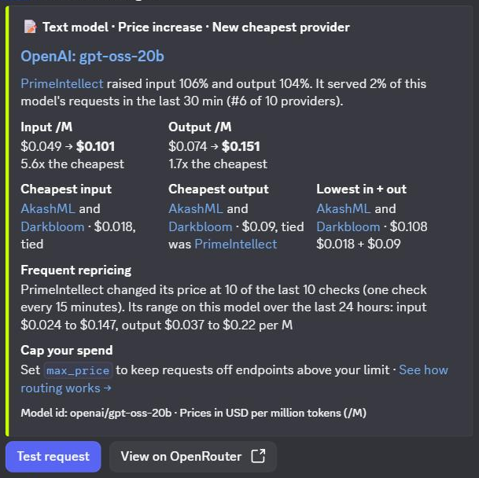
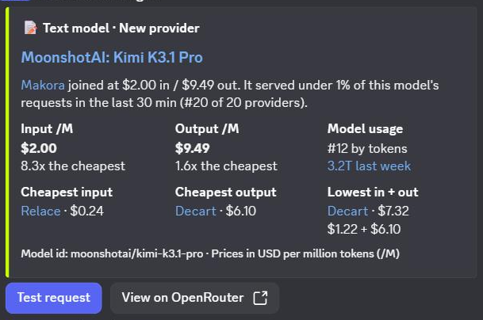
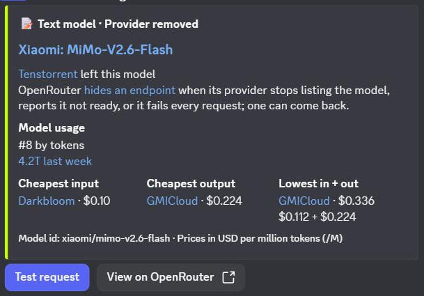

# OpenRouter pool history

Pool history is an independent record of providers joining and leaving OpenRouter models and changing their listed input or output price, with a check scheduled every 15 minutes. It is not affiliated with OpenRouter and started on Nov 17, 2026. Follow it on the [website](https://tiny-herb.github.io/pool-history/), in the [RSS feed](https://tiny-herb.github.io/pool-history/feed.xml) or [JSON Feed](https://tiny-herb.github.io/pool-history/feed.json), or through a Discord bot you can run yourself (see [Running it](#running-it)).

**Jump to:** [In short](#in-short) · [What the posts look like](#what-the-posts-look-like) · [Try it](#try-it) · [The pain](#the-pain) · [Why this approach](#why-this-approach) · [Technical choices](#technical-choices) · [Learnings](#learnings) · [Running it](#running-it)

## In short

For a model with several providers, OpenRouter picks one for each request. When a provider joins a model, leaves it or raises its price there, OpenRouter publishes no notice, and its price history keeps only the current providers' prices. Pool history is a dated record that keeps them all. It reads OpenRouter's public API with no key on a 15-minute schedule, keeps each change it detects with its date, and publishes the changes as a site, feed and Discord posts. On a post, the **Test request** button sends an ordinary request, plus a second to `:floor` on a model with two or more endpoints, and shows which provider served each.

## What the posts look like

These are real posts from the Discord bot and one Test request answer, cropped.

| | |
| --- | --- |
|  A price rise by a frequent repricer |  A new provider at 8.3x the cheapest input |
|  A provider that left |  The answer to a Test request: which provider served each of two real requests, shown only to the person who clicked |

## Try it

- Live: the [site](https://tiny-herb.github.io/pool-history/) and its [RSS feed](https://tiny-herb.github.io/pool-history/feed.xml).
- Locally, with Node.js 24 or later and no dependencies or key: `npm test`, then `npm run snapshot` (under a minute), `npm run build` and `npm run serve` (see [Commands](#commands)).
- With one snapshot the site shows the model count and no changes. Changes appear from the second snapshot on.

## The pain

OpenRouter serves many models through two or more providers that differ in price, quantization and reliability. Its default routing weighs effective price, throughput, time to first token, rate limits, errors and output quality, so the serving provider is not simply the cheapest ([How we rebuilt provider routing for better, faster inference](https://openrouter.ai/blog/announcements/how-we-rebuilt-provider-routing/), Oct 28, 2026). The model pages show each provider's price and price history, but a provider that leaves drops out of that history (on DeepSeek V3.2, even the All range draws only the six current providers).

This affects developers who send requests without pinning a provider. A pricier or lower-precision newcomer can take part of their traffic, and more if it is faster or the others falter. The cheapest provider can also leave. Their requests then cost more or behave differently, and OpenRouter sends them no notice.

**How I found it.**

I read and sorted developer comments in OpenRouter's Discord and on GitHub, Reddit, Hacker News and X, and retested the top complaints against the live API. Then I compared each complaint with what OpenRouter already shows, and the provider pool was what was left.

Today, OpenRouter's notifications cover deprecations and price drops on models and endpoints you recently used, and new models on Business and Enterprise plans. In the Discord, #new-models posts each new model from OpenRouter's RSS feed, and #providers is a forum with a thread for each of about 50 providers. None of these says when a provider joins or leaves a model or raises its price there. Pool history is a sibling to #new-models, for providers.

Some of what I read. Discord links open only for members of OpenRouter's server.

- A team's traffic on one model went to a new provider at about 9x the price for five days, with "No notice that a much more expensive provider had been added". [Discord, Nov 9, 2026](https://discord.com/channels/1091220969173028894/1569331815351717928)
- A provider's price rose about 10x in a few days, and the poster guessed that many users had picked it for being cheap. [Discord, Aug 28, 2026](https://discord.com/channels/1091220969173028894/1094454198688546826/1542763898992726028)
- A help thread asked whether StreamLake had left DeepSeek V3.2, and the answer bot replied that it could not confirm whether the removal was permanent. [Discord, Sep 24, 2026](https://discord.com/channels/1091220969173028894/1552628754126348348) A Wayback Machine copy of the model's page lists 14 providers on Sep 25, 2026. Pool history's own record shows 6 on Nov 17, 2026 (snapshot `2026-11-17T2050Z`).
- A developer said a model had suddenly got worse, and a volunteer moderator's first reply was "Which provider are you being routed to?" [Discord, Sep 14, 2026](https://discord.com/channels/1091220969173028894/1094454198688546826/1549179825720266943)
- A user who did not know where to find the serving provider wrote "I don't know which provider I was on when this happened", although the provider is in every response. [Hacker News, Sep 2026](https://news.ycombinator.com/item?id=49664337)

## Why this approach

The gap worth filling was a record of change over time:

- A front page with up to 20 changes from the last seven days, and an All changes page with every recorded change.
- An RSS feed and a JSON Feed, one item per model per check. The RSS feed has the shape of OpenRouter's new-models feed, so a Discord RSS bot can post it the way #new-models is posted.
- A Discord bot that posts each notable change, with a **Test request** button (see [Technical choices](#technical-choices)).

**What I deliberately did not build.**

I tested the top pain points, then prototyped and dropped an exploration for each of the three that reproduced best. Each was audited against three questions: does OpenRouter already do this, is the problem still current, and is it small enough to be easily understandable? None passed all three.

- **Cost Doctor** looked for [wasted spend](https://discord.com/channels/1091220969173028894/1094454198688546826/1556703900432728155). Model pages already show effective price and cache hit rate per provider, and the gap I measured shrank in a later test.
- **Route Preflight** predicted whether a request would fail, such as [a 402 with $72 in credits](https://discord.com/channels/1091220969173028894/1094454198688546826/1542526453579518053). My credit rule, fitted to refusals on one account, disagrees with how OpenRouter's docs describe the credit check. In Nov 2026 responses, OpenRouter's "No endpoints found" 404 already named the routing steps that removed the endpoints.
- **Provider Scorecard** tested providers for [broken tool calls](https://github.com/OpenHands/software-agent-sdk/issues/6283). Model pages already show each provider's tool-call error rate, routing for tool calls (Auto Exacto, on by default) weighs it, and neither the reported failures nor the two I saw recurred.

Inside pool history I also left out:

- Provider profile pages.
- A Test request, and a cheapest-provider comparison, for models not priced per token, such as image and video models.
- Units for speech and transcription prices, which the API gives with no unit field. They show as listed, and their changes are still reported.
- Any record of who clicks the Test request button.
- Alerts to a developer about the models they use, such as a subscription per model or provider.
- Hosting for the Discord bot, which posts only while I run it on my machine.

**What I would do next.**

- Host the bot, so it posts without my machine running.
- Add a per-model unit table for speech and transcription prices.
- Log Test request use, to learn whether anyone clicks it.
- Add a page per provider, listing its changes across models.
- Let a developer follow only the models or providers they use.

## Technical choices

**Read the public API, without a key.**

Each check reads `/api/v1/models?output_modalities=all`, each model's `/endpoints`, and the video and image price lists, six at a time, retrying a 429 or 5xx up to three times. A model list that is empty, or under 80% of the last full one, is refused.

**Keep a snapshot only when something changed.**

The history is stored as files on the repository's `data` branch. To keep that branch small, the first check of each UTC day saves every model, and later checks save only the models that changed, or nothing.

**One writer.**

Only the scheduled GitHub Actions job checks, and the bot posts from the `data` branch it writes. Two checkers would keep two histories that disagree about when a change happened.

**No dependencies.**

Node 24 and its standard library, a static site on GitHub Pages, and RSS and JSON Feed for delivery.

**What counts as notable.**

The site lists every recorded change and the feeds the newest 200 items, except a frequent repricer's routine moves, which the site folds into one row a day and the feeds leave out. For text models, only the listed input and output prices per token (after any provider discount) are compared, not cache prices or per-request fees. Moves of 0.5% or less are ignored. The bot posts about:

- a new provider
- a provider still missing 30 minutes after it disappeared
- an input or output price that rises 10% or more, or goes from free to paid, unless the provider is a frequent repricer
- a frequent repricer that becomes, or stops being, the cheapest (at most once per model in 24 hours)
- a price range that widens past 3x because the priciest provider rose
- a model removed from OpenRouter's list, or left with no providers

Posts about a newcomer whose blended price (three parts input to one part output) is 3x the cheapest or more, a rise of 25% or more, or a widened range also suggest `max_price`. Quantization is recorded too, but no change in it has been recorded yet.

**Test request.**

The button appears on posts for models priced per token, and only the person who clicked sees the answer. Each request is `Reply with exactly: ok`, capped at 16 tokens, with reasoning off where the model allows it and no tools, so it does not show how a tool-calling request is routed. **Test my settings** sends one with the member's own max price, sort and provider lists. Tests stop for the rest of the UTC day once they have spent $2.

- **Model selection.** It watches every model in OpenRouter's catalogue, and a Test request goes to the model named in the post.
- **Routing.** The first request uses default routing to show which provider served an ordinary request. Routing is a weighted random choice, so another request may go elsewhere. With two or more endpoints, a second goes to `<model>:floor`, or is sent with `sort: "price"` when the id has a `:` variant. The answer takes the providers considered from the router metadata, and the serving provider, cost and attempts from the generation record (or the response, if the record is not ready).
- **Fallbacks.** The bot sends no `models` fallback list and no provider `order`, because a fallback would hide what the test exists to show. If OpenRouter itself fell back, the answer says how many tries it took.
- **Streaming.** None, because the reply is at most 16 tokens and the provider and cost come from the generation record afterwards.

## Learnings

**What worked.**

- Reading the public API with no key, so anyone can rerun the check.
- One writer of the history, so the site, the feeds and the bot agree on when a change happened.

**What went wrong.**

- One provider drowned the first change list. PrimeIntellect changed prices at 17 of the first 19 logged checks, so deciding what is notable mattered more than collecting the data.
- A provider missing from one check had not always left, hence the 30-minute wait and "briefly unlisted".
- "Price" is not one number. My first video and image posts said "Price not listed per token", although OpenRouter lists those prices elsewhere, and speech and transcription units are still undone.
- Two bot processes on one Discord token broke the buttons.

**What I would do differently.**

- Decide what counts as notable before building the feed.
- Write down the unit of every price before showing one.
- Host the bot and log Test request use from the start.

**What I am least sure of.**

- The thresholds (30 minutes to confirm a departure, 8 changing checks, and at least half the checks, in 24 hours for a frequent repricer, 10% for a post) were chosen before a day of real checks existed. The record starts on Nov 17, 2026.
- Only one real change on a video model has been recorded so far (a 33% price rise on Seedance 2.0 Fast), and none on an image model, so those posts are tested mostly on example responses.
- No quantization change has been recorded yet either, so that event is tested only on example data.
- GitHub's schedule is best effort, so it decides how even the 15 minutes are.
- The tests cover the rules for what is a change and what earns a post, and the exact post and feed output, with fakes in place of the network. They do not cover Discord end-to-end or live OpenRouter responses, which I checked by hand.

## Running it

### How the public site stays current

The workflow `.github/workflows/update.yml` is scheduled to run `scripts/publish.mjs` at minutes 7, 22, 37 and 52 of every hour. Each run does these steps:

1. It restores the snapshots and the check log from the `data` branch.
2. It runs one check against OpenRouter's public API, without a key, and rebuilds the site.
3. It pushes the new check to `data` and the built site to `gh-pages` in one atomic push. GitHub Pages serves `gh-pages`.

If the check or the build fails, the run pushes nothing. GitHub turns schedules off in a public repository after 60 days without activity.

### Commands

| Command | What it does |
| --- | --- |
| `npm test` | Runs the tests. |
| `npm run snapshot` | Reads the public API once and writes one snapshot file to `data/snapshots`. |
| `npm run build` | Writes the pages, the JSON, `feed.xml` and `feed.json` from `data/snapshots` to `site/`. |
| `npm run serve` | Serves `site/` at <http://127.0.0.1:8787/>. |
| `npm run watch -- --history-from origin/data` | Runs the Discord bot with no check of its own. It copies the `data` branch into `data/` and posts new changes from it now, then at minutes 12, 27, 42 and 57. Run exactly one per Discord token, from a clone whose `origin` is the GitHub repository. |
| `npm run post -- --dry-run` | Prints the posts for pending changes instead of sending them. |

`node pool-history.mjs` with no command lists the other commands and options.

### Environment variables

`watch` and `post` read these from the environment or a `.env` file, which must never be committed.

| Variable | Used for |
| --- | --- |
| `DISCORD_BOT_TOKEN` | The bot. `post` fails without it (except with `--dry-run`), and `watch` skips posting. |
| `DISCORD_CHANNEL_ID` | The channel that receives the posts, with `DISCORD_BOT_TOKEN`. |
| `OPENROUTER_API_KEY` | The **Test request** button, and the usage and request-share lines on the posts. |
| `SITE_URL` | Optional for the bot. With the public site's address set, posts link back to the site. The GitHub workflow sets it for the published feed, so you do not need it in `.env`. |

The snapshot, build and serve commands need none of these.
